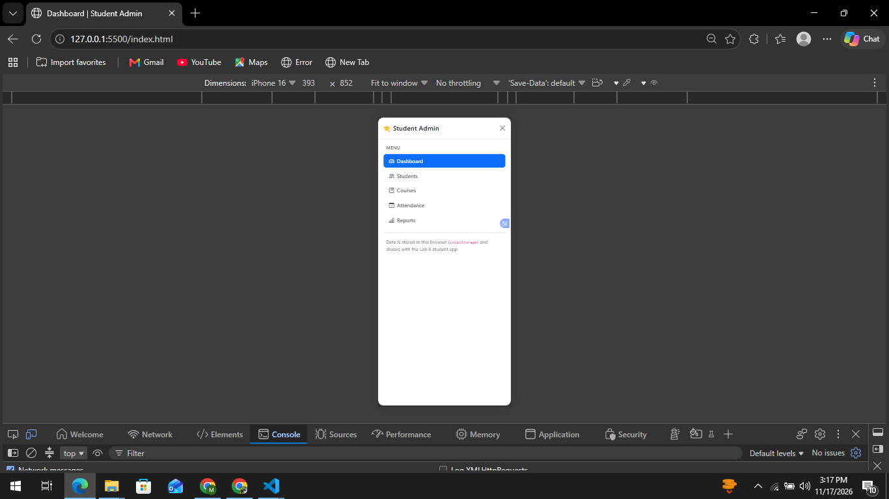

Bootstrap 5 Professional Admin Dashboard





Student admin dashboard built with **HTML + Bootstrap 5.3 + JavaScript**. Bootstrap and Bootstrap Icons are
included locally in `assets/vendor/` (the manual allows "CDN or local package"), so it works offline.

## Run it
1. Copy the `admin` folder into `C:\xampp\htdocs\`
2. Start Apache in XAMPP
3. Open http://localhost/admin/
4. First time: click **Load sample data** (16 students + 5 days of attendance), or add your own students.

## Folder structure (as in the manual, plus JS modules)
```
admin/
├── index.html         dashboard: KPI cards, filters, student table, department chart
├── students.html      full student management (search, filter, sort, pagination, import/export)
├── courses.html       course catalog
├── attendance.html    mark and save daily attendance
├── reports.html       summary cards + tables, print, CSV export
└── assets/
    ├── css/style.css      small custom CSS (Bootstrap utilities are used first)
    ├── js/store.js        data layer (localStorage)
    ├── js/ui.js           alerts, pagination, helpers
    ├── js/students.js     student table + add/edit/view/delete modals
    ├── js/dashboard.js    KPI cards + department bars
    ├── js/courses.js  js/attendance.js  js/reports.js
    └── vendor/            Bootstrap 5.3.3 + Bootstrap Icons 1.11.3
```

## Lab requirements covered
| Requirement (manual) | Where |
|---|---|
| Bootstrap 5, grid and components | every page; `row g-3`, `col-12 col-md-6 col-xl-3`, cards, tables, modals, alerts, pagination, progress bars |
| Navbar + sidebar layout | `navbar` on top; sidebar column on every page |
| **Responsive offcanvas sidebar** (Basic) | `offcanvas-lg offcanvas-start`: static sidebar from 992px up, slide-in menu below it (hamburger button) |
| KPI cards (reference implementation) | `index.html`: Students, Departments, Courses, Attendance rate; `card h-100` pattern from the manual |
| Student table, responsive | `table-responsive`; email and department columns hide on small screens |
| Add-student modal | `#studentModal` with Bootstrap validation (required, min length, email format, duplicate email) |
| Alert messages | dismissible Bootstrap alerts after add/edit/delete/save/import, plus info and error alerts |
| Pagination | Bootstrap `pagination` component (5 per page on the dashboard, 10 on Students) |
| **Dashboard filtering** (Basic) | search + department + semester filters; the table, KPI cards and department chart all update |
| **Report page with summary cards and tables** (Basic) | `reports.html` |
| Utility classes before custom CSS | `style.css` is about 30 lines |
| **Advanced: integrate Lab 6 localStorage data** | uses the same `students` key as Lab 6 (see below) |
| Test with device emulation | see "Screenshots" |

## Lab 6 integration
The dashboard reads and writes the `students` array in `localStorage`, the same key used in Lab 6.
Pages on the same origin share it, so with XAMPP (`http://localhost/students-ui/` and `http://localhost/admin/`)
students added in Lab 6 appear here and the other way round.

- Expected record: `{ id, name, email, department, semester }`. Older names (`fullName`, `dept`, `sem`) are also read.
- Saving keeps every record's original shape: unknown fields (for example `phone`) are not lost and numeric
  `semester`/`id` values stay numbers.
- If Lab 6 runs on a different address or port (for example VS Code Live Server), the browser keeps separate
  storage. Use **Export JSON** in one app and **Import JSON** on the Students page here.
- If the stored value is not valid JSON, a red warning is shown and the page does not crash.

## Calculations
- Attendance % = (Present + Late) / all marks recorded.
- "Students" on the Courses page = students of that department who are currently in the semester the course is offered.

## Test cases (fill Actual Result and Status for your report)
| ID | Action | Expected |
|----|--------|----------|
| TC-01 | Open with no data | Info alert with "Load sample data"; KPIs 0; table says "No students yet" |
| TC-02 | Load sample data | 16 students, 4 departments, 12 courses, attendance rate shown |
| TC-03 | Filter Computer Science + semester 3 | 2 students; Courses KPI becomes 1 |
| TC-04 | Add student with empty form | Modal stays open, invalid fields highlighted |
| TC-05 | Add with email `abc`, then an existing email | "valid email" message, then "already registered" |
| TC-06 | Add a valid student | Modal closes, green alert, Students KPI +1, new student first |
| TC-07 | Edit, then Delete (cancel, then confirm) | Record updated; cancel keeps it; confirm removes it with an alert |
| TC-08 | Resize below 992px, press the menu button | Sidebar slides in as an offcanvas and closes with the X |
| TC-09 | Mark attendance, Save, reload | Counts and marks are still there |
| TC-10 | Reports page | Matrix totals equal the number of students; shares add up to 100% |
| TC-11 | Import a JSON file with a duplicate and an invalid record | Valid ones added, others skipped, summary alert |

## Screenshots to take for submission
1. Dashboard on desktop (KPI cards, filters, table, department chart)
2. The **Add Student modal** (ideally showing a validation error), and the success alert after saving
3. Mobile view (375px) with the **offcanvas sidebar open**: F12, then Ctrl+Shift+M, choose a phone size, press the menu button
4. Reports page
5. Optional: tablet view, DevTools > Application > Local Storage showing `students`

## Troubleshooting (from the manual)
- **Bootstrap styles missing:** check that `assets/vendor/bootstrap/css/bootstrap.min.css` loads (F12 > Network).
- **Modal does not open:** check that `bootstrap.bundle.min.js` loads before the page scripts.
- **Layout overflows:** inspect `container-fluid > row > col` nesting.
